# IFTTT 모바일 앱으로 알림 받기 — ThingSpeak × IFTTT Webhook 연동

> 창의설계입문 11주차 과제 · 김주영 (202601527)

ThingSpeak 채널에 기록된 센서값이 임계값(30)을 넘으면, 서버 간 HTTP 호출(Webhook)을 거쳐 휴대폰 IFTTT 앱으로 푸시 알림이 오도록 구성했다.
이 문서에서는 설정 과정뿐 아니라 **각 구성요소가 어떤 원리로 동작하는지**, **겪은 문제와 원인 분석**, **임베디드 기기로 확장하는 방법**까지 정리했다.

---

## 목차
1. [시스템 구조](#1-시스템-구조)
2. [배경 개념](#2-배경-개념)
3. [IFTTT Applet 구성](#3-ifttt-applet-구성)
4. [ThingSpeak 채널](#4-thingspeak-채널)
5. [ThingHTTP — Webhook 연결](#5-thinghttp--webhook-연결)
6. [React — 호출 조건](#6-react--호출-조건)
7. [API Request로 값 기록](#7-api-request로-값-기록)
8. [실험 결과](#8-실험-결과)
9. [트러블슈팅 기록](#9-트러블슈팅-기록)
10. [심화 분석](#10-심화-분석)
11. [확장: ESP32 + 온도 센서](#11-확장-esp32--온도-센서)
12. [한계와 개선 방향](#12-한계와-개선-방향)

---

## 1. 시스템 구조

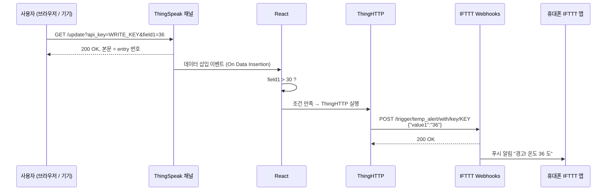

| 구성요소 | 역할 | 왜 필요한가 |
|---|---|---|
| ThingSpeak 채널 | 데이터 저장소 (시계열 DB) | 센서값을 기록하고 그래프로 보여 주기 때문 |
| React | 조건 감시자 | 값이 들어올 때마다 조건을 검사해 이벤트를 만들어 내기 때문 |
| ThingHTTP | HTTP 요청 템플릿 | React는 스스로 외부 URL을 호출할 수 없어서, 미리 저장된 요청을 대신 보내 주는 장치가 필요하기 때문 |
| IFTTT Webhooks | 외부 요청 수신부 | 임의의 HTTP 요청을 IFTTT의 트리거로 바꿔 주기 때문 |
| IFTTT Notifications | 푸시 발송 | 휴대폰에 알림을 보내려면 앱 개발·푸시 서버 없이도 IFTTT 앱을 수신기로 쓸 수 있기 때문 |

---

## 2. 배경 개념

### 2.1 Webhook — Polling과의 비교
- **Polling**: 클라이언트가 주기적으로 "새 데이터 있어?"라고 묻는 방식이다. 변화가 없어도 요청이 계속 발생해서 트래픽이 낭비되고, 알아채는 데 최대 한 주기만큼 지연된다.
- **Webhook**: 이벤트가 발생한 쪽이 **미리 등록된 URL로 HTTP 요청을 보내 알려 주는** 방식이다(역방향 API, HTTP 콜백). 이벤트가 있을 때만 요청이 생기기 때문에 효율적이고 지연이 짧다.
- 임베디드에 비유하면 Polling은 **폴링 루프**, Webhook은 **인터럽트**에 해당한다.

### 2.2 HTTP GET vs POST
| 구분 | GET | POST |
|---|---|---|
| 데이터 위치 | URL 쿼리스트링 (`?field1=36`) | 요청 본문(Body) |
| 용도 | 조회, 간단한 값 전달 | 데이터 생성·전송 |
| 이 과제에서 | ThingSpeak에 값 기록 (`/update`) | ThingHTTP → IFTTT (JSON Body로 값 전달) |

ThingHTTP에서 POST를 쓴 이유는 `value1`을 JSON Body에 담아 보내기 위해서다. GET으로 두면 Body가 전송되지 않아서 IFTTT의 `{{Value1}}`이 비어 버린다.

### 2.3 JSON과 Content-Type
IFTTT는 Body를 JSON으로 해석해 `value1`, `value2`, `value3` 키를 찾는다. 그래서 헤더에 `Content-Type: application/json`이 있어야 하고, 키 이름은 소문자 `value1`이어야 한다. IFTTT Webhook이 받을 수 있는 값은 **최대 3개(value1~3)**다.

### 2.4 ThingSpeak API Key
| 키 | 권한 | 노출 시 위험 |
|---|---|---|
| Write API Key | 채널에 값 기록 | 누구나 가짜 값을 기록할 수 있고, 그 값으로 React와 알림이 발동될 수 있다 |
| Read API Key | Private 채널 읽기 | 데이터 유출 |
| IFTTT Webhook Key | 내 Applet 트리거 | 누구나 내 크레딧으로 알림을 보낼 수 있다 |

> 이 문서의 모든 캡처에서 키는 가렸다.

---

## 3. IFTTT Applet 구성

- **If This**: Webhooks → *Receive a web request* (Event Name: `temp_alert`)
- **Then That**: Notifications → *Send a notification from the IFTTT app*
- **메시지**: `경고! 온도 {{Value1}} 도 ({{OccurredAt}})`
  - `{{Value1}}`: 요청 Body의 `value1` 값
  - `{{OccurredAt}}`: 이벤트 발생 시각

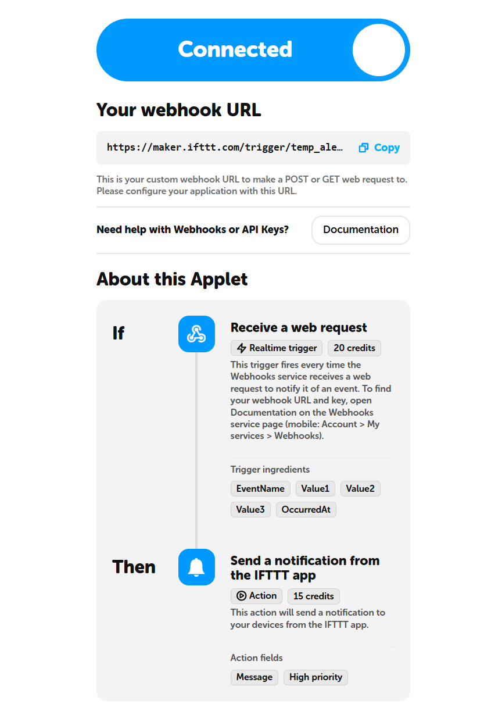
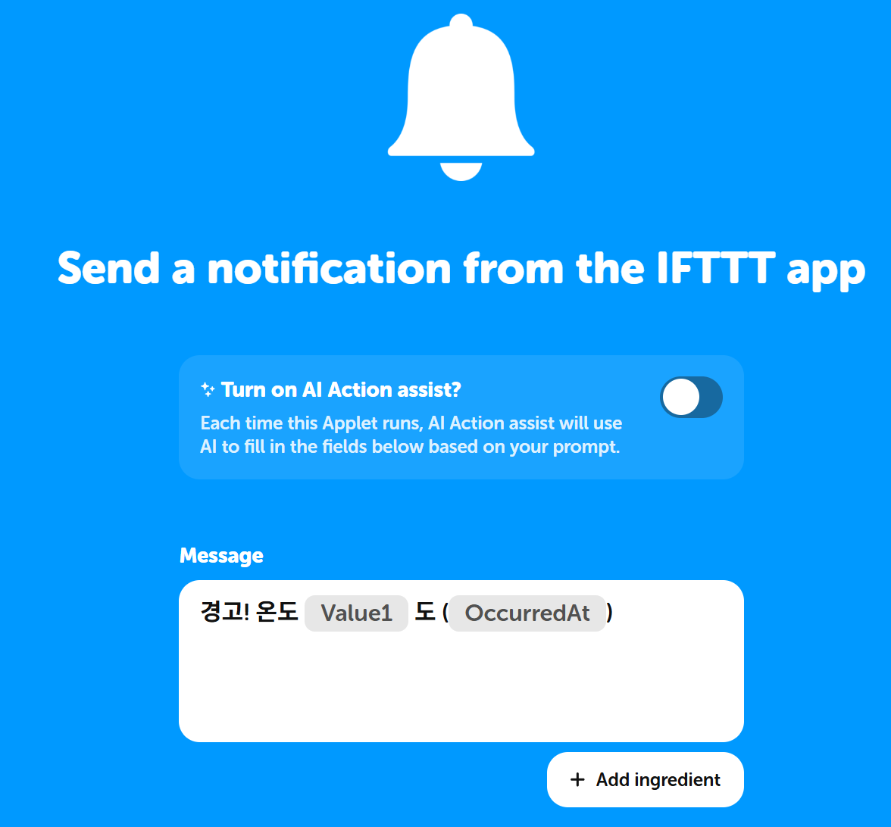

Webhook 호출 주소 형식:
```
https://maker.ifttt.com/trigger/{event}/with/key/{webhooks_key}
```
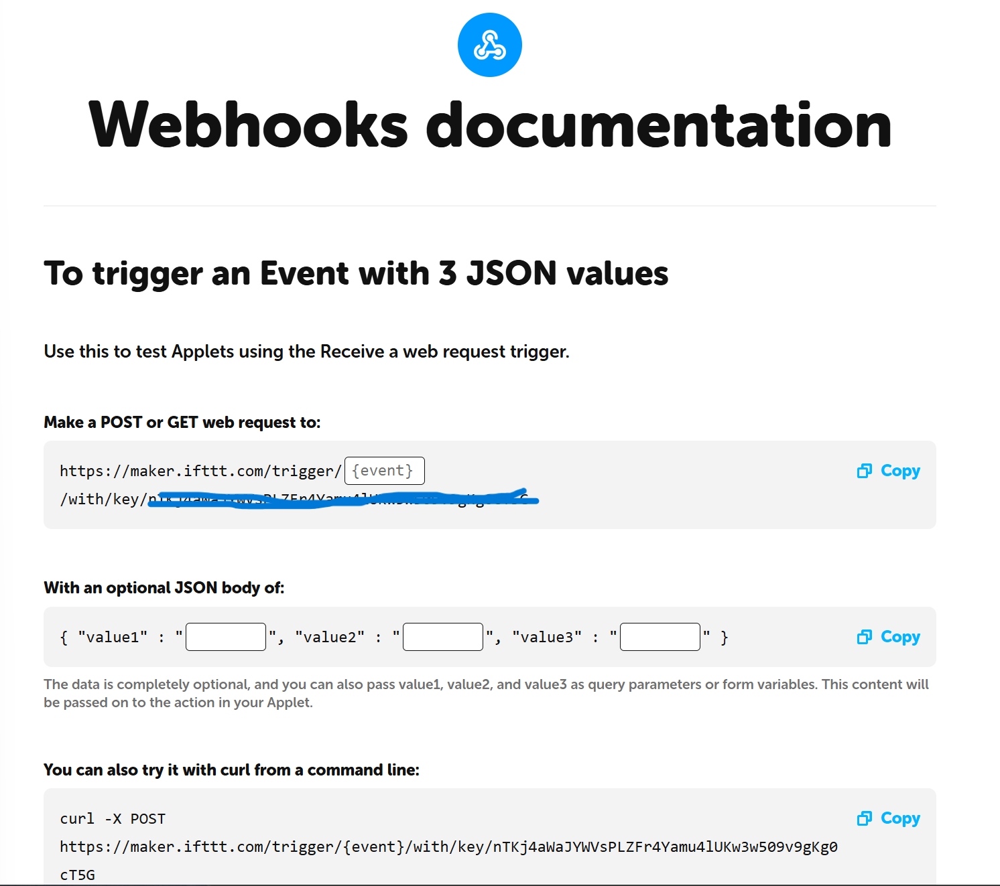

### 단독 테스트
ThingSpeak와 연결하기 전에 IFTTT만 따로 검증했다. 문제가 생겼을 때 어느 구간이 원인인지 나눠서 찾기 위해서다.
```bash
# 값 없이 호출
curl https://maker.ifttt.com/trigger/temp_alert/with/key/KEY

# JSON으로 값 전달
curl -X POST -H "Content-Type: application/json" \
     -d '{"value1":"36"}' \
     https://maker.ifttt.com/trigger/temp_alert/with/key/KEY
```

---

## 4. ThingSpeak 채널

| 항목 | 값 |
|---|---|
| Channel Name | IFTTT_Alert_Test |
| Field 1 | Temperature |

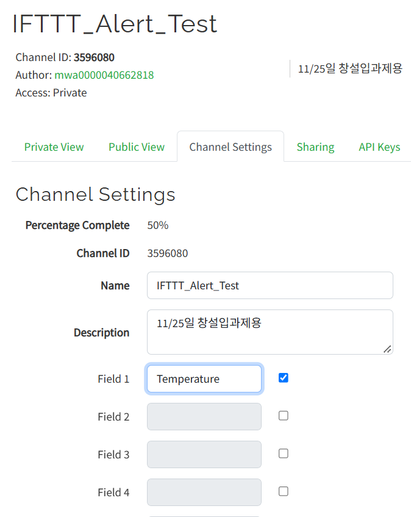

---

## 5. ThingHTTP — Webhook 연결

| 항목 | 값 |
|---|---|
| URL | `https://maker.ifttt.com/trigger/temp_alert/with/key/KEY` |
| Method | POST |
| Content Type | application/json |
| Body | `{"value1":"%%trigger%%"}` |

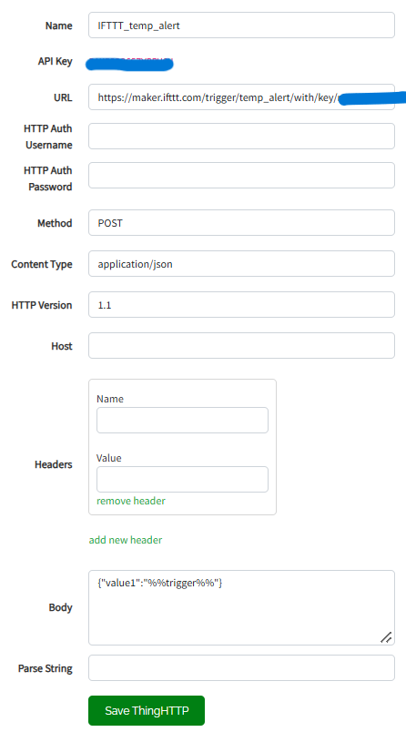

### 변수 치환
ThingHTTP는 React가 실행할 때 Body 안의 `%%...%%` 토큰을 실제 값으로 바꿔서 보낸다.

| 토큰 | 치환되는 값 |
|---|---|
| `%%trigger%%` | React를 발동시킨 값 (예: 36) |
| `%%channel_id%%` | 채널 ID |
| `%%channel_채널ID_field_1%%` | 해당 채널 field1의 최신 값 |

여러 값을 함께 보내도록 확장할 수 있다.
```json
{"value1":"%%trigger%%", "value2":"%%channel_id%%"}
```

---

## 6. React — 호출 조건

| 항목 | 값 | 선택 이유 |
|---|---|---|
| Condition Type | Numeric | 수치 비교이기 때문 |
| Test Frequency | On Data Insertion | 값이 들어오는 즉시 검사해야 지연이 최소가 되기 때문 (주기 검사면 최대 그 주기만큼 늦어짐) |
| Condition | field 1 **is greater than** 30 | 임계값 |
| Action | ThingHTTP → IFTTT_temp_alert | |
| Options | Run action each time condition is met | 실험에서 매번 동작을 확인하기 위해 |

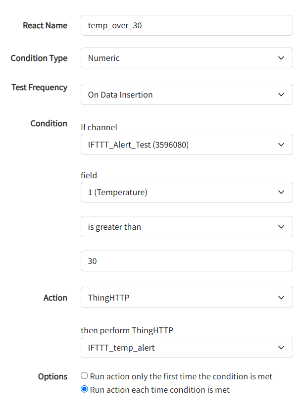

---

## 7. API Request로 값 기록

```
https://api.thingspeak.com/update?api_key={WRITE_KEY}&field1=36
```

| 응답 본문 | 의미 |
|---|---|
| `1`, `2`, `3`… | 기록 성공 (채널의 entry 번호) |
| `0` | 기록 실패 (15초 제한 위반, 잘못된 키 등) |

무료 계정은 **업데이트 간격이 최소 15초**다. 서버 부하를 막기 위한 rate limit이라, 그보다 빨리 보내면 응답이 `0`이 된다.

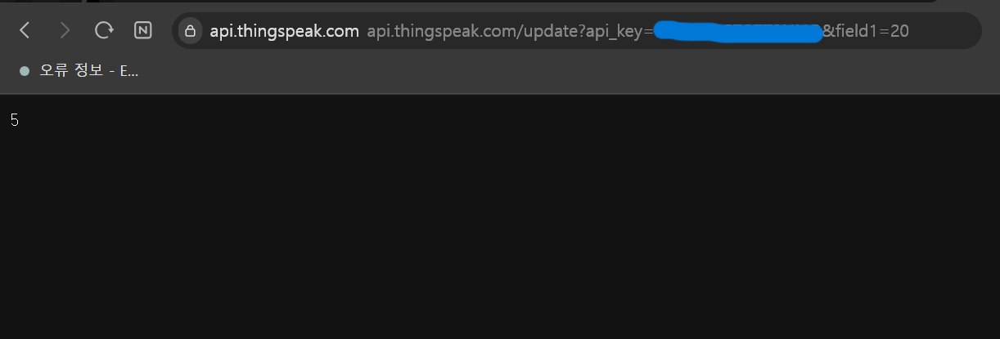

---

## 8. 실험 결과

### 8.1 조건별 동작
| 보낸 값 | 조건 (>30) | React | IFTTT 실행 | 휴대폰 알림 |
|---|---|---|---|---|
| 36 | 만족 | 실행 | O | O (값 36 표시) |
| 20 | 불만족 | 미실행 | X | X |
| 30 | 불만족 (경계값) | (측정 후 기입) | | |

> 30을 넣은 경계값 테스트로 `greater than`이 **30 초과**(30 미포함)라는 걸 확인할 수 있다.

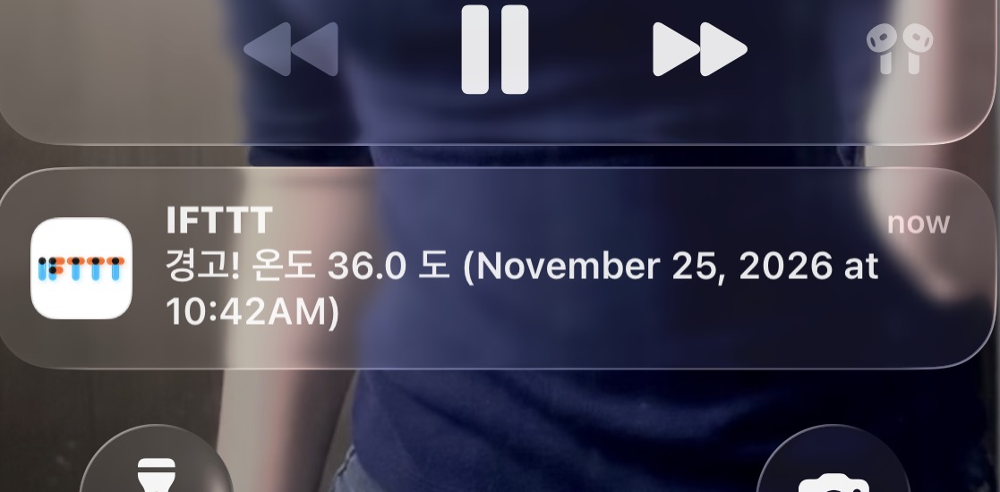
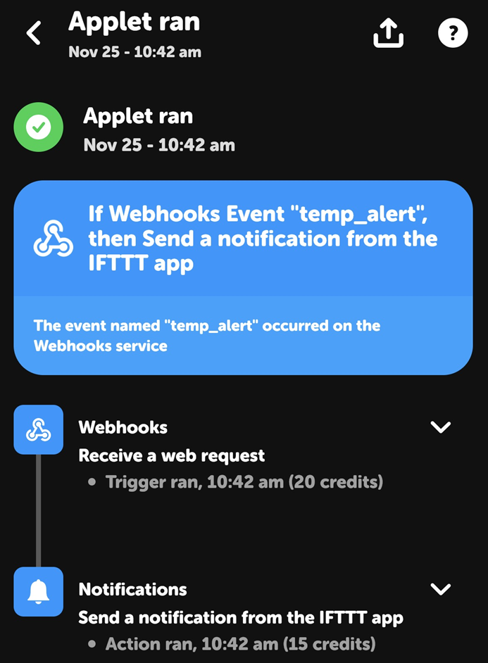
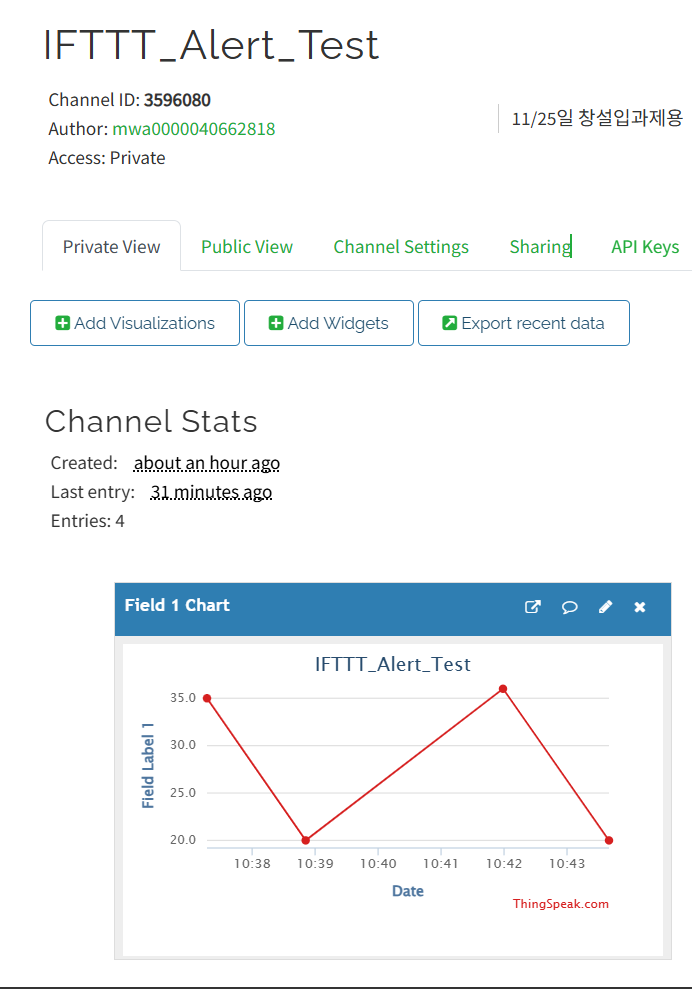

### 8.2 지연 시간
| 시도 | API 요청 시각 | 알림 수신 시각 | 지연 |
|---|---|---|---|
| 1 | (기입) | (기입) | (기입) 초 |
| 2 | (기입) | (기입) | (기입) 초 |

> 지연은 ThingSpeak의 React 처리, ThingHTTP 요청, IFTTT의 처리, Apple 푸시 서버(APNs) 전달을 모두 합친 값이다.

---

## 9. 트러블슈팅 기록

### 문제 1. Applet은 실행됐는데 휴대폰에 알림이 오지 않음
- **현상**: IFTTT Activity에 *Trigger ran*, *Action ran*이 모두 성공으로 찍혔지만 알림이 오지 않았다.
- **원인 분석**: Activity가 성공이라는 건 IFTTT 서버까지는 정상이라는 뜻이다. 그래서 원인을 **"서버 → 기기" 구간**으로 좁혔다. iPhone의 *Settings → Notifications* 목록에 IFTTT가 아예 없었다. iOS는 앱이 알림 권한을 한 번이라도 요청해야 이 목록에 앱을 올리는데, 그 요청이 이뤄지지 않은 상태였다.
- **해결**: 앱을 삭제했다가 다시 설치하고, 로그인할 때 뜬 권한 팝업에서 **Allow**를 선택했다.
- **배운 점**: 파이프라인을 구간별로 나눠서 각 단계의 로그를 확인하면 원인을 빠르게 좁힐 수 있다.

### 문제 2. 알림은 왔지만 값이 표시되지 않음
- **현상**: 35를 기록하자 알림이 왔지만 숫자가 없었다.
- **원인 분석**: 알림 문구가 IFTTT 기본 메시지(`The event named "temp_alert" occurred...`)였다. 데이터는 전달됐지만 **메시지 템플릿에 값을 꽂을 자리(`{{Value1}}`)가 없었다.**
- **해결**: 메시지를 `경고! 온도 {{Value1}} 도`로 바꾸고 36으로 다시 테스트했다. 이전 값(35)과 다른 값을 써서, 표시된 숫자가 새 요청에서 온 것인지 구분할 수 있게 했다.

### 구간별 점검 표
| 확인 위치 | 정상 신호 | 실패 시 의심 구간 |
|---|---|---|
| API 응답 | entry 번호 ≠ 0 | 키, 15초 제한 |
| 채널 그래프 | 새 점 추가됨 | 기록 실패 |
| IFTTT Activity | 새 실행 기록 있음 | 없으면 React / ThingHTTP |
| 휴대폰 | 알림 수신 | Activity가 있는데 알림이 없으면 기기 권한 |

---

## 10. 심화 분석

### 10.1 Level Trigger vs Edge Trigger
React의 Options는 디지털 회로·인터럽트의 트리거 방식과 같은 개념이다.

| Options | 동작 | 트리거 방식 |
|---|---|---|
| Run action each time condition is met | 조건이 참인 동안 **값이 들어올 때마다** 실행 | Level-triggered |
| Run action only the first time the condition is met | 조건이 거짓→참으로 **바뀌는 순간**에만 실행 | Edge-triggered |

**Level 방식의 문제**: 센서가 15초마다 31을 보내면 1분에 4번 알림이 온다. 실행 1회에 약 35 크레딧(Trigger 20 + Action 15)이 들기 때문에 약 140 크레딧/분이 소모되고, **무료 플랜의 월 1,000 크레딧은 7분 정도면 바닥난다.**
실제 서비스에서는 Edge 방식을 쓰는 게 합리적이다. "넘어선 순간"만 알리면 되기 때문이다.

### 10.2 히스테리시스(Hysteresis)
값이 30 근처에서 29.9 ↔ 30.1처럼 흔들리면 Edge 방식이어도 알림이 반복된다. 슈미트 트리거처럼 **경보 ON 기준과 OFF 기준을 다르게** 두면 이를 막을 수 있다.
```
경보 ON  : 값 > 30
경보 OFF : 값 < 28   (2도 여유)
```
ThingSpeak React만으로는 상태를 기억하기 어렵기 때문에, 기기 쪽 코드나 MATLAB Analysis에서 구현해야 한다 (11장 코드 참고).

### 10.3 설계 비교
| 방식 | 장점 | 단점 |
|---|---|---|
| 현재 구조 (React → ThingHTTP → IFTTT) | 코드 없이 설정만으로 구성 | 거치는 서비스가 많아 지연·장애 지점이 늘어남, 크레딧 제한 |
| 기기가 IFTTT를 직접 호출 | 지연 감소 | 기기에 키가 저장되고, 데이터 기록과 알림 로직이 기기에 섞임 |
| ThingSpeak 자체 Alerts (이메일) | 외부 서비스 불필요 | 푸시 알림이 아니라 이메일 |

현재 구조는 **"데이터 수집(기기)"과 "판단·알림(클라우드)"을 분리**한다는 장점이 있다. 그래서 임계값을 바꿀 때 기기 펌웨어를 다시 올릴 필요 없이 React 설정만 바꾸면 된다.

---

## 11. 확장: ESP32 + 온도 센서

브라우저로 직접 보낸 API Request를 실제 기기로 대체하면 완전한 IoT 시스템이 된다. 아래는 ESP32와 DHT11 센서로 같은 URL을 호출하는 예시 코드다 (Arduino IDE 기준, **이번 과제에서는 실행하지 않은 확장 예시**).

```cpp
#include <WiFi.h>
#include <HTTPClient.h>
#include "DHT.h"

#define DHTPIN   4
#define DHTTYPE  DHT11
#define TH_ON    30.0   // 경보 ON 기준
#define TH_OFF   28.0   // 경보 OFF 기준 (히스테리시스)

const char* ssid     = "WIFI_SSID";
const char* password = "WIFI_PASSWORD";
const char* writeKey = "WRITE_API_KEY";

DHT dht(DHTPIN, DHTTYPE);
bool alarmOn = false;

void setup() {
  Serial.begin(115200);
  dht.begin();
  WiFi.begin(ssid, password);
  while (WiFi.status() != WL_CONNECTED) delay(500);
}

void loop() {
  float t = dht.readTemperature();
  if (!isnan(t)) {
    // 히스테리시스: 상태가 바뀔 때만 alarm 필드를 갱신
    if (!alarmOn && t > TH_ON)  alarmOn = true;
    if ( alarmOn && t < TH_OFF) alarmOn = false;

    HTTPClient http;
    String url = String("http://api.thingspeak.com/update?api_key=") + writeKey
               + "&field1=" + String(t, 1)
               + "&field2=" + (alarmOn ? "1" : "0");
    http.begin(url);
    int code = http.GET();
    if (code == 200) Serial.println("entry: " + http.getString());
    else             Serial.printf("HTTP error: %d\n", code);
    http.end();
  }
  delay(20000);   // 15초 rate limit보다 길게
}
```

이 코드에서는 React 조건을 `field2 == 1`로 두고 Options를 *only the first time*으로 바꾸면 된다. 그러면 **히스테리시스 + Edge Trigger**가 함께 적용돼서, 온도가 30을 넘는 순간에 알림이 한 번만 온다.

---

## 12. 한계와 개선 방향
- **크레딧 제한**: 무료 플랜은 월 1,000 크레딧이라 실행 횟수가 약 28회로 제한된다. Edge Trigger와 히스테리시스로 불필요한 실행을 줄여야 한다.
- **단일 장애점**: ThingSpeak, IFTTT, APNs 중 하나만 멈춰도 알림이 오지 않는다. 중요한 경보라면 이메일 Alerts를 함께 두는 이중화를 고려할 수 있다.
- **보안**: 기기 코드에 Write Key가 평문으로 들어가고 HTTP로 전송된다. HTTPS를 사용하고 키를 주기적으로 재발급하는 게 바람직하다.
- **값 전달 개수**: IFTTT Webhook은 value1~3만 지원하기 때문에, 여러 센서값을 보내려면 문자열로 합치거나 다른 방식을 써야 한다.

---

## 참고 자료
- MathWorks, *React to Channel Activity with Notification from IFTTT*
- MathWorks, *ThingHTTP App* / *React App* 문서
- IFTTT Help Center, *What is the Webhooks service?*
